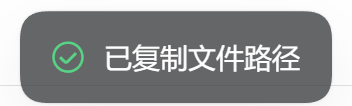
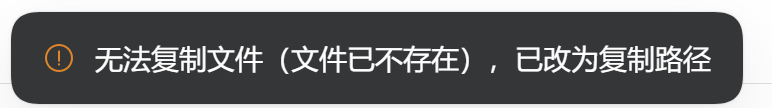

# dsh-copy-file

**Put the real file from a DSH delivery card on the system clipboard** — not its path, not its text: a file you can `Ctrl+V` into File Explorer, WeChat, Feishu, or a mail attachment field.

English | [中文](README.md)

---

## The problem

DSH's `present` tool renders delivery cards that can open a file, preview it in the Sidebar, or reveal it. To send that file to someone you had to open it and "save as".

A browser cannot help: the Clipboard API writes text and bitmaps only, and there is **no way to put a file list on the OS clipboard** (Windows needs `CF_HDROP`). So this extension does the direct thing:

> menu click → a same-origin, already-authenticated DSH route → the Host resolves the real path from the Session log → a **short-lived PowerShell child** calls `Clipboard.SetFileDropList`.

**The browser never supplies a path.** It supplies "which Session, which delivery event, which file index"; the Host looks the rest up in the immutable Session log and the Session filesystem.

---

## What you get

Three new rows inside the existing dropdown; the shipped "open with" entries and the "show file location" footer are untouched:

| Row | Behavior |
|---|---|
| **Copy file** | The file itself (CF_HDROP). Paste into Explorer, WeChat, Feishu, mail attachments |
| **Copy all N files** | Every file of the same `present` call, on the clipboard at once (shown only when N > 1) |
| **Copy file path** | The absolute path, as **text** |
| On failure | Degrades to copying the path and says **why** (file gone / clipboard busy / unsupported platform) — it never pretends to succeed. Only when even the path cannot reach the clipboard does it say "Copy failed. Try again." |

Cards also get Windows-style interaction:

- **single click selects** (reusing DSH's own hover fill — no new visual language);
- **double click opens the Sidebar preview** (Enter / Space too);
- **Ctrl+C on the selected card copies that file**;
- **drag** shows a translucent ghost of the card's own file icon plus the name;
  - drop **inside the page** → attaches the file to the current conversation (every browser);
  - drop on **File Explorer** → lands a copy (Chromium only).

## Screenshots

All three shots come from a live `dsh web` session and are cropped to the control itself, so no
workspace path, session title, or file name is visible:

| the three copy rows | a successful copy | a degraded copy |
|---|---|---|
|  |  |  |


## Support

| Capability | Chromium (Edge, Chrome, Brave, Opera) | Firefox | Safari |
|---|---|---|---|
| Copy file / all / path | ✅ | ✅ | ✅ |
| Select, double-click, Ctrl+C | ✅ | ✅ | ✅ |
| Drag into the conversation | ✅ | ✅ | ✅ (14.1+) |
| Drag onto File Explorer | ✅ | ❌ not implemented by the engine | ❌ |

Copying does not depend on the browser: the clipboard write happens in the Host process.
Dragging out does: it relies on the non-standard `DownloadURL` payload. Firefox and Safari get **no drag source at all** rather than a gesture that drops nothing.

Platform: **Windows 11 + `dsh web`**, tested. macOS and Linux paths exist (`osascript`, `wl-copy`/`xclip`) but are **untested**.

---

## Install

Requires Node 22.19+ and **Windows PowerShell 5.1** (the scripts carry a UTF-8 BOM and do not need pwsh 7). Both DSH **0.2.0-rc.2** (`dsh web`) and the Electron **0.2.1-rc.3** build are supported.

```powershell
git clone <this-repo> dsh-copy-file
cd dsh-copy-file
powershell -ExecutionPolicy Bypass -File scripts/install.ps1
```

Then **quit DSH completely and start it again** (quit the Electron app; restart `dsh web` for the CLI profile), and open a session with a file card.

> Without `-Profile` the installer auto-detects: `profiles\desktop` wins when it lists `@deepseek-ai/dsh-web-app`, otherwise `web`. The Electron app owns that profile, so `dsh --dump-config` refuses it — the installer downgrades that to a warning.

> Why a restart: DSH's live config reload removes rows fine, but a row naming a package it has not resolved before is not picked up until launch (verified: `window.__DSH_BOOT__` stays without it).

### What it touches

Only your profile. **No file inside the DSH installation is modified.**

```
%USERPROFILE%\.dsh\profiles\web\
├─ package.json                    ← appends "dsh-copy-file" to dsh.profile.bundles
├─ node_modules\dsh-copy-file\     ← this package
└─ .dsh-copy-file\install.json     ← the pre-install bundle list, for exact rollback
```

No pnpm, no network, no registry, no service, no autostart.

---

## Uninstall

```powershell
powershell -ExecutionPolicy Bypass -File scripts/uninstall.ps1
```

Removes only its own entry from `dsh.profile.bundles` (bundles you added later survive), then deletes the package and the record and clears any helper process or autostart entry. Refresh the page: removal applies live (`__DSH_BOOT__` returns to the shipped row and cards behave natively again).

---

## Verify

```powershell
powershell -ExecutionPolicy Bypass -File scripts/verify.ps1                  # installed
powershell -ExecutionPolicy Bypass -File scripts/verify.ps1 -ExpectAbsent    # after uninstall
```

Checks package integrity, that `lib/client.js` matches the installed upstream bundle, the profile manifest, and the composed configuration (`dsh --profile <profile> --dump-config`: our row present and the shipped row disabled, or the inverse). That section reports SKIP on the Electron profile, by design.

Without a GUI:

```powershell
node tests/clipboard.test.mjs      # real clipboard: CJK, spaces, quotes, 220-char path, multi-file, missing
node tests/presented.test.mjs      # coordinate resolution and every refusal
node tests/routes.test.mjs         # the four routes plus the degraded response
node tests/client-bundle.test.mjs  # the browser half loads and registers six slots + dictionaries
```

---

## Security and privacy

- **No listening socket.** A copy spawns one `powershell.exe -STA` child that exits when done.
- **Same authentication as `present.open`**: DSH's login cookie and Host/Origin fence. No second token.
- **No arbitrary paths**: the routes have no path parameter; the Server resolves coordinates against an append-only log and the Session filesystem, then requires the Host path to round-trip through this process.
- **No content reads**: `stat` only; the bytes go to the OS clipboard API, never through the plugin.
- **No network, no telemetry.**
- The threat model is "someone already logged into this local DSH".

---

## Compatibility

Supported releases: **DSH 0.2.0-rc.2 and 0.2.1-rc.3 (Electron)**. `vendor-client.mjs` gates on a `SUPPORTED_VERSIONS` whitelist; both releases share one `lib/client.js` (the upstream `ui-open-in-app` bundle did not change, `--check` reports current). When there is no on-disk dsh to compare against (the Electron build keeps it inside `app.asar`), `--check` reports SKIP and installation uses the committed artifact. The shipped dropdown has no menu-item slot, so the only non-invasive way to add rows *inside* it is to vendor that browser package and splice three additive hunks, then replace the row through a bundle patch.

`lib/client.js` is generated:

```
src/copy-ui.js              ← all added code, readable and editable
lib/client.js               ← generated, do not hand-edit
scripts/vendor-client.mjs   ← regenerates from the installed DSH; fails loudly on a moved anchor
```

After a DSH upgrade: `--check` reports drift, `vendor-client.mjs` regenerates (and names the exact anchor that broke), reinstall, restart once.

Measured behavior: **adding a row needs a restart; removing one applies live.**

---

## Upstream suggestion

The vendored bundle exists only because the shipped dropdown has no menu-item slot.
An issue draft for upstream lives in [docs/upstream-issue.md](docs/upstream-issue.md) — landing it would delete the fork entirely.

---

## Known limitations

- Dragging onto Explorer is Chromium-only; whether WeChat/Feishu accept the drop is up to them.
- The Windows **taskbar never accepts file drops.** Hovering a taskbar button during any drag —
  including a drag started in File Explorer itself — shows the "no entry" cursor. Drop into an
  open folder's file list, or onto the desktop, instead.
- `DownloadURL` only lands on a **filesystem target**. Folder icons in Explorer's tree, taskbar
  buttons, and other applications refuse it, and Windows does not raise the target window while
  you drag — make the folder window visible first.
- A **native drag out of a card** was not fully reproduced in a real window (the debug window was not foreground, so synthetic OS input never reached the page); the `DownloadURL` mechanism itself was verified on a standalone page (Edge 155, CJK name preserved). The in-page drop was verified with a real `dragstart`+`drop`.
- Paths beyond 260 characters may be truncated by some drop targets.
- Files outside the Session workspace are refused, matching the existing "open file" boundary.
- **Renaming or moving a file** makes the card stale (the Session log is immutable); "Copy file path" still works and is tested.
- The application list in the menu is long — that is the shipped behavior.
- macOS, Linux and the Electron desktop app are untested.

---

## Development notes

- `pwsh 7` has no `Set-Clipboard -Path` (Windows PowerShell 5.1 does), so the writer uses `System.Windows.Forms.Clipboard.SetFileDropList` with `-STA`.
- Paths never travel through a command line; they go through a temporary UTF-8 JSON file.
- `ConvertFrom-Json` returns one object for an array, so `@(...)` nests it — flatten with a `ForEach-Object`.
- Console code pages mangle CJK; read results back through a UTF-8 file, not stdout.
- When replacing an upstream row, also change the module id, the locale namespace and the slot occupant id, or a hot swap double-registers.

---

## License

MIT — see [LICENSE](LICENSE). `lib/client.js` is a derivative of `@deepseek-ai/dsh-client-ui-open-in-app` (MIT); attribution in [NOTICE](NOTICE).
