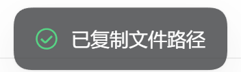
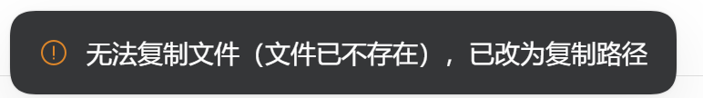

# dsh-copy-file

**Put the real file from a DSH delivery card on the system clipboard** — not its path, not its text: a file you can `Ctrl+V` into File Explorer, WeChat, Feishu, or a mail attachment field.

English | [中文](README.md)

---

## The problem

DSH's `present` tool renders delivery cards that can open a file, preview it in the Sidebar, or reveal it. To send that file to someone you had to open it and "save as".

A browser cannot help: the Clipboard API writes text and bitmaps only, and there is **no way to put a file list on the OS clipboard** (Windows needs `CF_HDROP`). So this extension does the direct thing:

> menu click → a same-origin, already-authenticated DSH route → the Host resolves the real path from the Session log → a **short-lived PowerShell child** calls `Clipboard.SetFileDropList`.

**The browser never supplies a path.** It supplies "which Session, which delivery event, which file index"; the Host looks the rest up in the immutable Session log and the Session filesystem.

---

## What you get

One **copy icon** beside the card's "Open in" split button. The shipped "open with" entries and the "show file location" footer are untouched — still there, still the same button; this one just sits next to it:

| Gesture | Behavior |
|---|---|
| **Click the icon** | The file itself (CF_HDROP). Paste into Explorer, WeChat, Feishu, mail attachments |
| **Right-click the icon** (the chevron beside it, in `menu`) | "Copy all N files" (shown only when N > 1) and "Copy file path" |
| On failure | Degrades to copying the path and says **why** (file gone / clipboard busy / unsupported platform) — it never pretends to succeed. Only when even the path cannot reach the clipboard does it say "Copy failed. Try again." |

Two presentations (`config.presentation`, default `icon`): `icon` is the single button with a
right-click menu; `menu` adds a chevron that opens the same menu.

Cards also get Windows-style interaction:

- **single click selects** (reusing DSH's own hover fill — no new visual language);
- **double click opens the Sidebar preview** (Enter / Space too);
- **Ctrl+C on the selected card copies that file**;
- **drag** shows a translucent ghost of the card's own file icon plus the name;
  - drop **inside the page** → attaches the file to the current conversation (every browser);
  - drop on **File Explorer** → lands a copy (Chromium only).

## Screenshots

The last two shots come from a live `dsh web` session and are cropped to the control itself.
The first is the 0.1.x look (rows inside the "open with" dropdown); since 0.2.0 the action is its
own icon on the card, and that shot has not been retaken yet:

| 0.1.x dropdown (historical) | a successful copy | a degraded copy |
|---|---|---|
|  |  |  |


## Support

| Capability | Chromium (Edge, Chrome, Brave, Opera) | Firefox | Safari |
|---|---|---|---|
| Copy file / all / path | ✅ | ✅ | ✅ |
| Select, double-click, Ctrl+C | ✅ | ✅ | ✅ |
| Drag into the conversation | ✅ | ✅ | ✅ (14.1+) |
| Drag onto File Explorer | ✅ | ❌ not implemented by the engine | ❌ |

Copying does not depend on the browser: the clipboard write happens in the Host process.
Dragging out does: it relies on the non-standard `DownloadURL` payload. Firefox and Safari get **no drag source at all** rather than a gesture that drops nothing.

Platform: **Windows 11**, tested on both hosts: the Electron build (**0.2.1-rc.3 / 0.2.2-rc.5**) and `dsh web` (**0.2.0-rc.2**). macOS and Linux paths exist (`osascript`, `wl-copy`/`xclip`) but are **untested**.

---

## Install

Requires Node 22.19+ and **Windows PowerShell 5.1** (the scripts carry a UTF-8 BOM and do not need pwsh 7). **DSH 0.2.0-rc.2 or newer** — either `dsh web` or the Electron build; verified on 0.2.2-rc.5.

```powershell
git clone <this-repo> dsh-copy-file
cd dsh-copy-file
powershell -ExecutionPolicy Bypass -File scripts/install.ps1
```

Then **quit DSH completely and start it again** (quit the Electron app; restart `dsh web` for the CLI profile), and open a session with a file card.

> Without `-Profile` the installer auto-detects: `profiles\desktop` wins when it lists `@deepseek-ai/dsh-web-app`, otherwise `web`. The Electron app owns that profile, so `dsh --dump-config` refuses it — the installer downgrades that to a warning.

> Why a restart: DSH's live config reload removes rows fine, but a row naming a package it has not resolved before is not picked up until launch (verified: `window.__DSH_BOOT__` stays without it).

### What it touches

Only your profile. **No file inside the DSH installation is modified.**

```
%USERPROFILE%\.dsh\profiles\web\
├─ package.json                    ← appends "dsh-copy-file" to dsh.profile.bundles
├─ node_modules\dsh-copy-file\     ← this package
└─ .dsh-copy-file\install.json     ← the pre-install bundle list, for exact rollback
```

No pnpm, no network, no registry, no service, no autostart.

---

## Uninstall

```powershell
powershell -ExecutionPolicy Bypass -File scripts/uninstall.ps1
```

Removes only its own entry from `dsh.profile.bundles` (bundles you added later survive), then deletes the package and the record and clears any helper process or autostart entry. Refresh the page: removal applies live (`__DSH_BOOT__` returns to the shipped row and cards behave natively again).

---

## Verify

```powershell
powershell -ExecutionPolicy Bypass -File scripts/verify.ps1                  # installed
powershell -ExecutionPolicy Bypass -File scripts/verify.ps1 -ExpectAbsent    # after uninstall
```

Checks package integrity, the browser half's slot contract (module id, no vendored upstream, the delivery slot, a patch that disables nothing, the client test), the profile manifest, and the composed configuration (`dsh --profile <profile> --dump-config`: our row present). That section reports SKIP on the Electron profile, by design.

Without a GUI:

```powershell
node tests/clipboard.test.mjs      # real clipboard: CJK, spaces, quotes, 220-char path, multi-file, missing
node tests/presented.test.mjs      # coordinate resolution and every refusal
node tests/routes.test.mjs         # the four routes plus the degraded response
node tests/client.test.mjs         # the browser half loads, registers 2 slots, dictionaries match
```

---

## Security and privacy

- **No listening socket.** A copy spawns one `powershell.exe -STA` child that exits when done.
- **Same authentication as `present.open`**: DSH's login cookie and Host/Origin fence. No second token.
- **No arbitrary paths**: the routes have no path parameter; the Server resolves coordinates against an append-only log and the Session filesystem, then requires the Host path to round-trip through this process.
- **No content reads**: `stat` only; the bytes go to the OS clipboard API, never through the plugin.
- **No network, no telemetry.**
- The threat model is "someone already logged into this local DSH".

---

## Compatibility

Compatibility is a contract, not a version number. The browser half needs three things:
`deliverables.file.actions` stays a `kind: list` slot; the card keeps passing
`actionUrl / available / pending / onAction`; the card root keeps `data-presented-file`.
Verified on **0.2.0-rc.2 / 0.2.1-rc.3 / 0.2.2-rc.5**; a newer release needs no adaptation
while those hold.

Why the vendoring is gone: the shipped dropdown has no menu-item slot, but the card's
**action area is itself a list slot** — registering a second occupant (`id: 'copy-file'`)
is enough, with no need to replace the upstream package. `0.2.2-rc.5` ships
`ui-open-in-app/lib/client.js` as a single minified line: 7 of the 9 splice anchors were gone
and `useDeliveryCard` no longer existed upstream, so the old pipeline **could not regenerate
at all** — while its `disabled: true` still matched the shipped row and would silently swap
the whole new open-in-app for the 0.2.1 copy (losing the file / image / URL / workspace
right-click menus, open-in-sidebar and open-in-float, and the Open locally shortcut).

`lib/client.js` is hand-written (~33 KB). Scripts and tests no longer generate it.

After a DSH upgrade: just reinstall. If the contract ever moves, the symptom is a missing
copy icon rather than an error, and `scripts/verify.ps1 [2]` plus `node tests/client.test.mjs`
report it first.

Measured behavior: **adding a row needs a restart; removing one applies live.**

---

## Upstream

`docs/upstream-issue.md` is a 0.1.x-era request (a menu-item slot inside the dropdown).
`0.2.x` already exposes `deliverables.file.actions` as a list slot, so the request is no
longer needed for this project; it is kept as history.

---

## Known limitations

- Dragging onto Explorer is Chromium-only; whether WeChat/Feishu accept the drop is up to them.
- The Windows **taskbar never accepts file drops.** Hovering a taskbar button during any drag —
  including a drag started in File Explorer itself — shows the "no entry" cursor. Drop into an
  open folder's file list, or onto the desktop, instead.
- `DownloadURL` only lands on a **filesystem target**. Folder icons in Explorer's tree, taskbar
  buttons, and other applications refuse it, and Windows does not raise the target window while
  you drag — make the folder window visible first.
- A **native drag out of a card** was not fully reproduced in a real window (the debug window was not foreground, so synthetic OS input never reached the page); the `DownloadURL` mechanism itself was verified on a standalone page (Edge 155, CJK name preserved). The in-page drop was verified with a real `dragstart`+`drop`.
- Paths beyond 260 characters may be truncated by some drop targets.
- Files outside the Session workspace are refused, matching the existing "open file" boundary.
- **Renaming or moving a file** makes the card stale (the Session log is immutable); "Copy file path" still works and is tested.
- The application list in the menu is long — that is the shipped behavior.
- macOS, Linux and the Electron desktop app are untested.

---

## Development notes

- `pwsh 7` has no `Set-Clipboard -Path` (Windows PowerShell 5.1 does), so the writer uses `System.Windows.Forms.Clipboard.SetFileDropList` with `-STA`.
- Paths never travel through a command line; they go through a temporary UTF-8 JSON file.
- `ConvertFrom-Json` returns one object for an array, so `@(...)` nests it — flatten with a `ForEach-Object`.
- Console code pages mangle CJK; read results back through a UTF-8 file, not stdout.
- When replacing an upstream row, also change the module id, the locale namespace and the slot occupant id, or a hot swap double-registers.

---

## License

MIT — see [LICENSE](LICENSE). `lib/client.js` is a derivative of `@deepseek-ai/dsh-client-ui-open-in-app` (MIT); attribution in [NOTICE](NOTICE).
